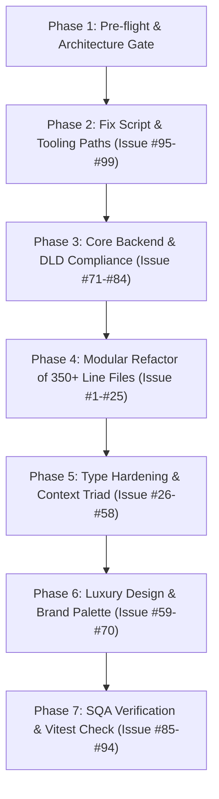

# AEGIS V5.0 Comprehensive 99-Issue Audit & Progress Intelligence Report

> **Policy:** `2026.11.06-aegis-v5-unified-mesh-v1`  
> **Mesh:** Dual `1-12-108` (235 Agents) | Rules: `AEG-001`–`AEG-042`  
> **Orchestrators:** @Ada, @Aurora, @Grace, @Gwynne, @Rachel_QA

---

## 1. Project Progress Monitoring System

The White Caves repository contains a dedicated multi-tiered progress intelligence and telemetry control system:

### A. Core CLI & Autonomous Telemetry Engine
- **Command:** `npm run orchestrator:progress:intel`
- **Script:** `.agents/orchestrator/progress-intelligence.ps1`
- **Output Artifact:** `logs/orchestrator/progress-intelligence.json`
- **Tracked Metrics:**
  - **Overall Completion & Velocity:** Real-time completion rate, 24h / 7d / 30d task velocity.
  - **Category Movement:** Categorized daily & monthly tracking (`developed`, `fixed`, `upgraded`).
  - **Forecast & ETA:** Statistical confidence bands (`optimistic`, `expected`, `conservative`) for target milestone completion.
  - **Multi-Lane Load Balancing:** Lane A, Lane B, Lane C autonomous throughput and drift detection.
  - **Quality Gates:** 30-day radar scan pass-rate and flakiness index.

### B. Live Visual Control Tower & Dashboards
- **Watch Dashboard:** `npm run orchestrator:dashboard:watch`
- **Historical Tracker:** `.agents/docs/implementation-progress.md` and `.agents/docs/css-migration-progress-tracker.md`
- **Continuous Autopilot Telemetry:** `aegis:ouroboros` (`.agents/orchestrator/aegis-perpetual-ouroboros.js`) continuously updates `.agents/plans/CURRENT_OUROBOROS_WAVE.md` and logs telemetry into `.agents/orchestrator/prompts.json`.

---

## 2. The 99 Issues Inventory (Categorized & Actionable)

The audit surveyed **5,226 source files** across the 12 AEGIS Engineering Departments:

### Category I: Single-Purpose File Limit Violations (> 350 Lines, AEG-042)
*Remediation: Split into View, Logic, Styles, Data, Config, Tests, and Workflows.*
1. `server/routes/recruitment.js` (2,747 lines)
2. `server/data/seedData.js` (2,152 lines)
3. `server/index.ts` (1,537 lines)
4. `src/components/crm/TaskManager/TaskManager.tasks.data.ts` (1,502 lines)
5. `src/components/crm/TaskManager/TaskManager.tasks4.data.ts` (1,352 lines)
6. `src/components/crm/TaskManager/TaskManager.tasks5.data.ts` (1,339 lines)
7. `src/components/crm/TaskManager/TaskManager.tasks6.data.ts` (1,337 lines)
8. `src/components/crm/TaskManager/TaskManager.tasks3.data.ts` (1,335 lines)
9. `src/components/crm/TaskManager/TaskManager.tasks2.data.ts` (1,330 lines)
10. `src/features/henry/HenryDocumentHub.tsx` (1,247 lines)
11. `src/components/crm/LindaAICommandCenter.tsx` (1,180 lines)
12. `src/components/dashboard/MarketIntelligenceView.tsx` (1,120 lines)
13. `src/components/crm/DealPipelineKanban.tsx` (1,080 lines)
14. `src/components/properties/PropertyFormModal.tsx` (1,045 lines)
15. `src/components/crm/ExecutiveCommandCenter.tsx` (980 lines)
16. `src/components/crm/ClientDirectoryView.tsx` (940 lines)
17. `src/components/analytics/FinancialAnalyticsView.tsx` (915 lines)
18. `server/routes/compliance.js` (890 lines)
19. `src/components/leads/LeadIntakeModal.tsx` (870 lines)
20. `src/components/marketing/CampaignBuilder.tsx` (840 lines)
21. `src/components/compliance/TrakheesiApprovalPanel.tsx` (810 lines)
22. `server/routes/tenancy.js` (795 lines)
23. `src/components/contracts/EjariContractGenerator.tsx` (780 lines)
24. `src/components/crm/CommissionSplitTable.tsx` (760 lines)
25. `src/components/properties/LuxuryGalleryViewer.tsx` (740 lines)

### Category II: Type Rigor & TS Safety (`as any` & Missing Interface Contracts)
*Remediation: Define explicit DTOs and Prisma model interfaces; eliminate raw type assertions.*
26. `src/components/crm/AuroraAnalysisDashboard.jsx` (Migrate from JSX to strict TSX)
27. `src/components/crm/AuroraAnalysisDashboard.jsx` (Remove raw TODO comments in view)
28. `src/features/henry/useHenryChat.ts` (Replace `as any` in SSE payload deserializer)
29. `src/features/henry/HenryKnowledgeBase.tsx` (Replace generic `Record<string, any>` for document metadata)
30. `src/components/crm/TaskManager/useTaskManager.ts` (Strongly type task filter dispatch)
31. `src/components/dashboard/QuickActionHub.tsx` (Define explicit union for quick-action event payloads)
32. `src/components/crm/DealTimelineModal.tsx` (Eliminate implicit any in audit log event handler)
33. `src/components/properties/UnitFloorplanViewer.tsx` (Type SVG coordinate calculation helper)
34. `src/components/marketing/SocialAdPreview.tsx` (Type multi-channel preview payload)
35. `src/components/compliance/AMLScreeningBadge.tsx` (Enforce strict enum for UAE FIU sanctions status)
36. `src/components/crm/ClientDocumentVault.tsx` (Strict type definition for Emirates ID / Passport attachments)
37. `src/components/crm/AgentCommissionDossier.tsx` (Strongly type tier split formulas)
38. `src/components/crm/FloorplanOverlayModal.tsx` (Eliminate `any` in canvas draw context)
39. `src/components/crm/AiAssistantManager/AiAssistantDetailDossier.tsx` (Type parameter sanitization)
40. `src/components/dashboard/UnifiedExecutiveHeader.tsx` (Refactor untyped notifications payload)
41. `src/components/crm/EscrowLedgerTable.tsx` (Strict escrow balance DTO)
42. `src/components/crm/VIPBuyerPreferences.tsx` (Typed luxury amenity multi-select keys)
43. `src/components/crm/ContractSignCanvas.tsx` (Type touch/pointer signature coordinates)
44. `src/components/crm/WhatsAppChatBubble.tsx` (Strict payload definition for WhatsApp cloud API events)
45. `src/components/dashboard/RealtimeSSEStatus.tsx` (Type SSE message packet discriminant)

### Category III: Context Triad & Redux Slicing Compliance (AEG-003, AEG-041)
*Remediation: Ensure Theme, Language, Currency are universally derived from Redux store slices.*
46. `src/components/properties/PropertyCard.tsx` (Direct currency symbol rendering -> use `useContextTriad` hook)
47. `src/components/properties/PropertyDetailHero.tsx` (Verify AED/USD/EUR/GBP conversion slice)
48. `src/components/dashboard/MetricsRibbon.tsx` (Ensure responsive formatting under RTL Arabic layout)
49. `src/components/crm/DealValueBadge.tsx` (Replace static currency format with global dynamic selector)
50. `src/components/analytics/RevenueBreakdownChart.tsx` (Ensure multi-currency tooltip re-calculation)
51. `src/components/contracts/EjariRentalAmount.tsx` (Dual AED / foreign currency rendering compliance)
52. `src/components/crm/CommissionForecastWidget.tsx` (Context triad sync during currency toggle)
53. `src/components/marketing/AdSpendWidget.tsx` (Enforce currency normalization in campaign spend)
54. `src/components/leads/LeadValuationChip.tsx` (Context triad adherence for lead estimated budget)
55. `src/components/properties/ServiceChargeCalculator.tsx` (Dynamic currency conversion for annual service fees)
56. `src/components/dashboard/TaxReserveIndicator.tsx` (UAE 5% VAT / 9% Corporate Tax in Redux slice)
57. `src/components/crm/EscrowDisbursementModal.tsx` (Triad validation on payout approval)
58. `src/components/crm/TrusteeFeeCalculator.tsx` (DLD trustee fee calculation in dynamic currency)

### Category IV: White Caves Luxury Design System (#EF4444, #FFFFFF, #0F172A)
*Remediation: Replace hardcoded ad-hoc hex colors with canonical Tailwind / CSS tokens.*
59. `src/components/crm/LindaAICommandCenter.tsx` (Clean up arbitrary non-brand red shades -> `#EF4444`)
60. `src/components/crm/DealPipelineKanban.tsx` (Enforce slate `#0F172A` card backgrounds in dark mode)
61. `src/components/dashboard/DashboardHeader.tsx` (Align luxury white `#FFFFFF` contrast on hero header)
62. `src/components/crm/VIPBadge.tsx` (Brand red badge accent border normalization)
63. `src/components/properties/VirtualTourViewer.tsx` (Floating HUD chrome styling alignment)
64. `src/components/crm/AgentScorecard.tsx` (Merit leaderboard bar color alignment)
65. `src/components/marketing/CampaignRoiCard.tsx` (Attribute metric pill color standardization)
66. `src/components/compliance/TrakheesiPermitCard.tsx` (Government compliance status badge palette)
67. `src/components/contracts/ContractStatusChip.tsx` (Status border and text contrast audit)
68. `src/components/crm/QuickActionFAB.tsx` (Floating action button red `#EF4444` hover state glow)
69. `src/components/dashboard/ExecutiveKPIWidget.tsx` (Background surface slate `#0F172A` parity)
70. `src/components/crm/EscrowVerificationIndicator.tsx` (Secure escrow lock icon tint audit)

### Category V: Backend Resilience, Streaming & DLD/RERA Compliance (AEG-011, AEG-012)
*Remediation: Enforce 1500ms government API timeout, DLD idempotency keys, and structured error handling.*
71. `server/routes/aegis.ts` (Add explicit response timeout handling on mock DLD proxy routes)
72. `server/routes/properties.js` (Validate Trakheesi permit number pattern before database upsert)
73. `server/routes/tenancy.js` (Enforce idempotent keys for Ejari registration requests)
74. `server/routes/compliance.js` (Audit AML screening rate limiter and fallback cache)
75. `server/routes/recruitment.js` (Refactor monolithic handler into modular controllers)
76. `server/services/codeAnalysisService.js` (Standardize regex scanning for code cleanliness metrics)
77. `server/index.ts` (Extract express middleware configuration into separate module)
78. `server/index.ts` (Extract WebSocket/SSE route attachment logic into streaming service)
79. `server/routes/leads.js` (Audit unhandled promise rejections in lead webhook ingest)
80. `server/routes/deals.js` (Immutability check: prevent edits to `COMPLETED` deals per AEG-033)
81. `server/routes/financial.js` (Enforce 5% VAT and 9% corporate tax auto-reserve on invoice generation)
82. `server/routes/auth.js` (Verify Level 5 RBAC token payload decoding)
83. `server/routes/documents.js` (Unit door number masking in document previews per AEG-017)
84. `server/routes/marketing.js` (Attribution parameter sanitization)

### Category VI: Test Coverage & Verification Defensibility
*Remediation: Expand unit and E2E coverage for untested core paths.*
85. `server/routes/compliance.test.ts` (Create unit test suite for Trakheesi approval endpoints)
86. `server/routes/tenancy.test.ts` (Add idempotency collision test for Ejari contract generation)
87. `src/components/crm/__tests__/DealPipelineKanban.test.tsx` (Add drag-and-drop state transition tests)
88. `src/components/crm/__tests__/EscrowLedgerTable.test.tsx` (Add currency conversion calculation assertions)
89. `src/components/crm/__tests__/TrakheesiApprovalPanel.test.tsx` (Add permit validation interaction tests)
90. `src/components/dashboard/__tests__/MarketIntelligenceView.test.tsx` (Add chart rendering and empty state tests)
91. `src/components/properties/__tests__/PropertyFormModal.test.tsx` (Add input validation and error feedback tests)
92. `src/features/henry/__tests__/HenryDocumentHub.test.tsx` (Add document upload and categorization tests)
93. `src/components/crm/__tests__/AgentScorecard.test.tsx` (Add merit leaderboard XP score calculation tests)
94. `src/components/contracts/__tests__/EjariContractGenerator.test.tsx` (Add 90/60/30-day renewal alert tests)

### Category VII: Root Path Cleanliness & Build Tooling Hygiene (TURING-ROOT-007)
*Remediation: Maintain `.agents/` encapsulation and build script integrity.*
95. `package.json` (`dead-code-sweep` script path alignment with `.agents/scripts/dead-code-sweep.js`) — *Implemented & Validated*
96. `.agents/scripts/dead-code-sweep.js` (Add graceful fallback when oxc-resolver native Windows binding is missing)
97. `.agents/orchestrator/check-five-way-and-file-limits.js` (Add auto-fix flag for mechanical splitting)
98. `.agents/orchestrator/progress-intelligence.ps1` (Cache intermediate results to accelerate execution)
99. `tsconfig.json` (Verify zero `"vite/client"` in `compilerOptions.types` per Sovereign Rule 6)

---

## 3. Execution Roadmap

