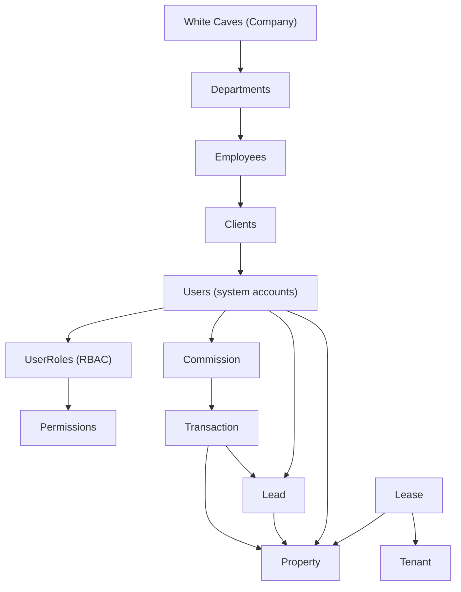
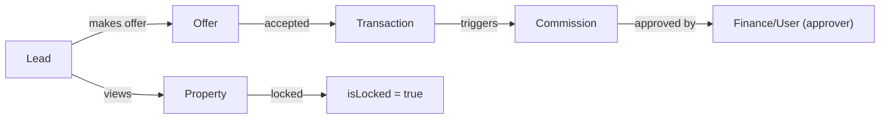
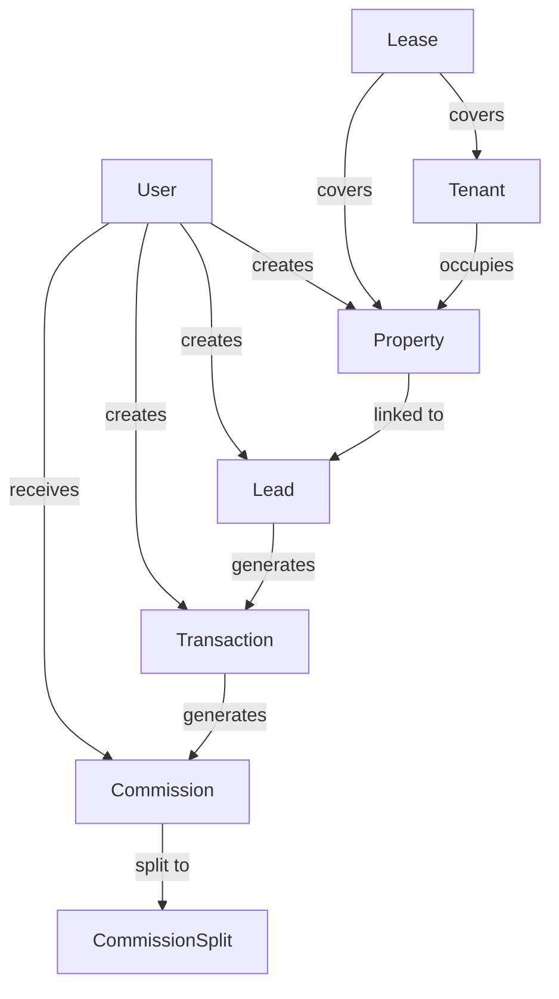

# ERMS – Unified Diagram View

This file aggregates all the core Mermaid flow‑charts for the Entity‑Relationship Management System (ERMS) in a single place. Open this markdown in any Mermaid‑compatible viewer (VS Code with the Markdown preview, GitHub, or a web‑based editor) to see the diagrams together in one tab.

---

## 1️⃣ Entity Hierarchy

---

## 2️⃣ Navigation Flow (Lead → Property → Transaction → Commission)

---

## 3️⃣ Detailed Relationship Map (selected core entities)

---

*All diagrams are rendered as SVG by Mermaid‑JS. Save or export them with the Mermaid CLI (`npx mmdc`) if you need separate image files.*

