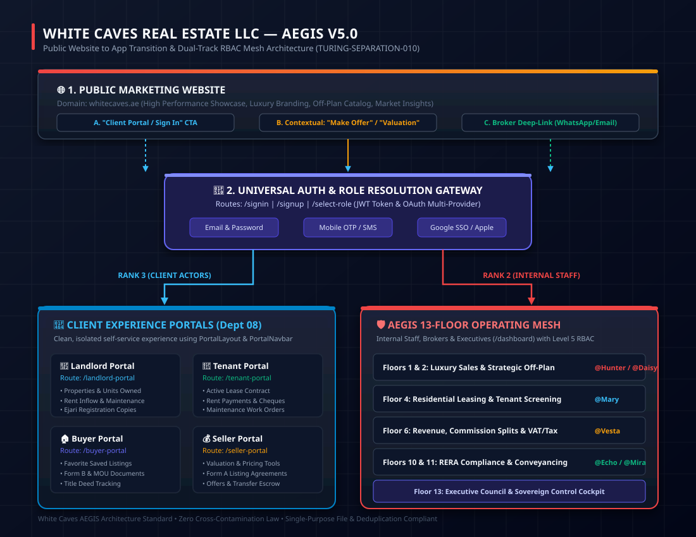
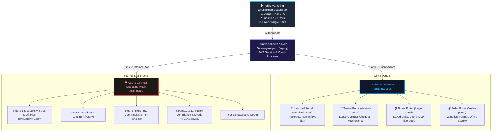

# AEGIS Architectural Guide: Public Website to Client & Staff App Onboarding Architecture

> **Policy:** `AEGIS-V5-ARCHITECTURE-AUTH` | **Domain:** White Caves Real Estate LLC  
> **Status:** Canonical Knowledge Base | **Applies to:** Public Portal (`whitecaves.ae`) & CRM/App (`app.whitecaves.ae`)  
> **Visual Reference:** [09-public-to-app-rbac-architecture.svg](./09-public-to-app-rbac-architecture.svg)

---

## 1. Overview & Sovereign Principles

In our architecture, White Caves cleanly decouples the **Public Marketing Website** from the **Protected App & CRM**.
This document serves as the permanent knowledge base for AEGIS and engineering teams to ensure:

1. **Migration Safety:** No breaking changes or regressions to running apps/databases while parallel work occurs in other chats.
2. **Deduplication:** Sub-features (e.g. Favorite Listings, Pricing Tools, Calculators) roll up into clean, dedicated Portals rather than orphaned pages.
3. **Optimization:** Modular lazy-loading keeps bundle sizes small, adherence to the 350-line single-purpose file law, and clean RBAC boundaries.

---

## 2. High-Level Visual Architecture

---

## 3. The 3 Primary User Ingestion Journeys

### Journey 1: Direct Entry ("Client Portal / Sign In")

- **Trigger:** A registered client or employee visits `whitecaves.ae` and clicks **"Sign In"** or **"Client Portal"**.
- **Path:** Direct navigation to `/signin` (with optional `returnTo` state).
- **Resolution:**
  - If role is `landlord` ➔ `/landlord-portal`
  - If role is `tenant` ➔ `/tenant-portal`
  - If role is `buyer` ➔ `/buyer-portal`
  - If role is `seller` ➔ `/seller-portal`
  - If role is staff/broker ➔ `/dashboard`

### Journey 2: Action-First Contextual Onboarding (Highest Conversion)

- **Trigger:** A guest performs an action on the public website:
  - _Buyer:_ Clicks _"Make an Offer"_ or _"Book VIP Tour"_.
  - _Seller/Landlord:_ Uses the _"Instant Villa Valuation"_ or _"List My Property"_.
  - _Tenant:_ Clicks _"Submit Rental Application / Ejari"_.
- **Workflow:**
  1. Captures form inputs in the public state.
  2. Presents instant authentication modal: _"Create an account to track this offer live"_.
  3. Seamlessly authenticates and redirects directly to the corresponding portal with the submitted item pre-loaded.

### Journey 3: Broker Deep-Linked Magic Link

- **Trigger:** An internal broker or conveyancer generates a Form B/F or Ejari draft from Floor 1, 4, or 11.
- **Notification:** WhatsApp / SMS / Email containing a secure magic link:
  `https://whitecaves.ae/signin?returnTo=/buyer-portal?dealId=DL-402`
- **Resolution:** Client logs in via 1-click OTP and lands directly on their document review screen.

---

## 4. Separation of Concerns & Law Compliance

| Law                         | Standard                                                          | Application in This Architecture                                                                                                                             |
| :-------------------------- | :---------------------------------------------------------------- | :----------------------------------------------------------------------------------------------------------------------------------------------------------- |
| **`TURING-SEPARATION-010`** | Clean separation of Actor (ERMS), Structure (DMS), and Task (TMS) | External clients never touch staff floor workspaces; they stay inside dedicated, streamlined Client Experience Portals.                                      |
| **`AEG-008` & `AEG-042`**   | Single Purpose & < 350 Lines per File                             | Sub-features (e.g. `FavoriteListings`, `MortgageCalculatorPage`) are reused as modular tab components inside the portal without monolithic file duplication. |
| **`TURING-LAW-000`**        | Zero-waste execution & safe parallel migration                    | Changes are purely configuration & component-level additions. No breaking database migrations or dependency churn.                                           |

---

## 5. Technical Routing & Portal Matrix

| Role               | Rank | Primary Destination | Portal Layout  | Key Capabilities                                                    |
| :----------------- | :--: | :------------------ | :------------- | :------------------------------------------------------------------ |
| **Landlord**       |  3   | `/landlord-portal`  | `PortalLayout` | Owned properties, tenant overview, rent payments, Ejari downloads   |
| **Tenant**         |  3   | `/tenant-portal`    | `PortalLayout` | Active lease, payment history, maintenance work orders              |
| **Buyer**          |  3   | `/buyer-portal`     | `PortalLayout` | Saved listings, active offers, mortgage calculator, DLD fees        |
| **Seller**         |  3   | `/seller-portal`    | `PortalLayout` | Property valuation, Form A agreements, offers received, NOC status  |
| **Broker / Staff** |  2   | `/dashboard`        | `AppShell`     | 13-Floor departmental operating mesh, full CRM tools, lead pipeline |
| **Executive**      |  2   | `/dashboard`        | `AppShell`     | Multi-floor cockpit, business telemetry, commission approvals       |

---

## 6. Implementation Phasing & Migration Protocol

To maintain complete isolation while parallel migrations occur in other chats:

1. **Phase 1: Portal Component Types Extension (`src/components/portal/`)**
   - Extend `PortalType` in `PortalNavbar.tsx` to include `'buyer' | 'seller' | 'landlord' | 'tenant'`.
   - Update `PortalNavbar` display tags and color branding.

2. **Phase 2: Modular Buyer & Seller Portal Views (`src/pages/`)**
   - `src/pages/buyer/BuyerPortalPage.tsx` (< 350 lines): Modularly integrates existing components (`FavoriteListings`, `MortgageCalculatorPage`, `DLDFeesPage`, `SavedSearches`).
   - `src/pages/seller/SellerPortalPage.tsx` (< 350 lines): Modularly integrates existing components (`PricingToolsPage`).

3. **Phase 3: Route Resolution & Legacy Redirects (`src/utils/routing.ts` & `App.redirects.data.ts`)**
   - Direct `buyer` ➔ `/buyer-portal` and `seller` ➔ `/seller-portal` in `getPostLoginRoute()`.
   - Update `/buyer/dashboard` and `/seller/dashboard` legacy redirects to target the dedicated portals.
   - Register routes in `App.routes.tsx` using `lazyRetry`.

4. **Phase 4: SQA Verification (< 2s targeted checks)**
   - Verify with `npx vitest run src/utils/routing.test.ts`.
   - Verify TypeScript compliance with `npx tsc --noEmit --skipLibCheck`.

---

## 7. Continuous Learning & Autopilot Integration

This document and its companion SVG diagram (`09-public-to-app-rbac-architecture.svg`) are stored under `.agents/docs/` so the sovereign orchestrator (`@Ada`, `@Aurora`, `@Zoe`, `@Nova`) automatically loads them during future task planning, code reviews, and autopilot cycles.
