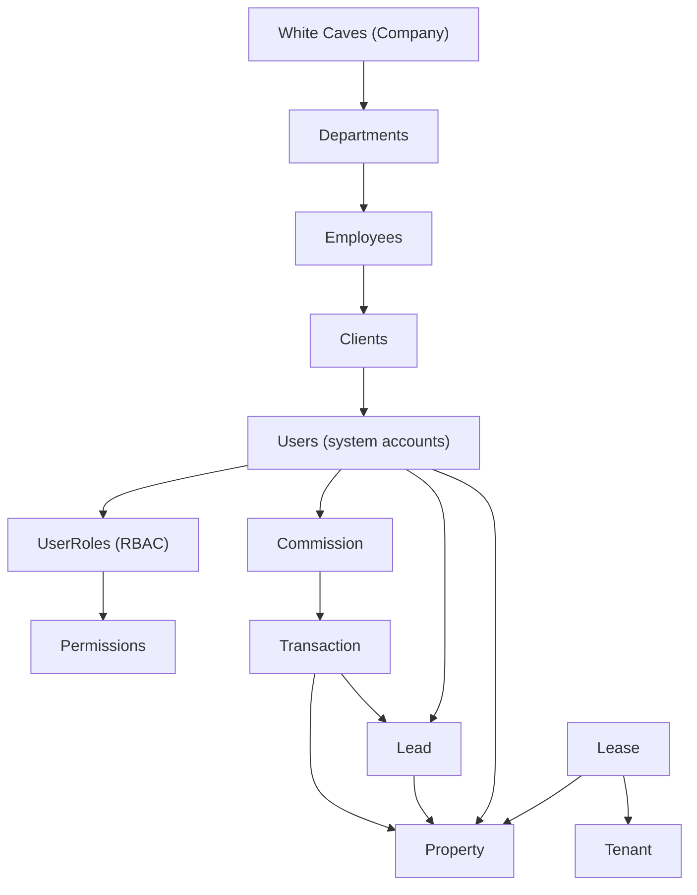
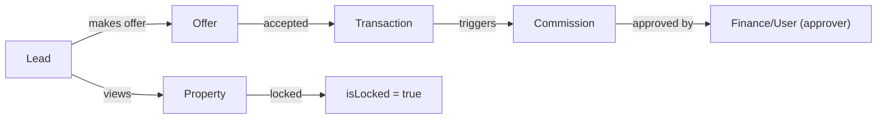

# Entities Management List & ERMS Overview

> **Purpose** – Central reference for all data‑model entities, their hierarchical grouping, relationships, navigation flows, and documented use‑cases.  It can be used by developers, product designers, and architects to plan new features or audit existing ones.

---

## 1️⃣ Hierarchical Entity Tree (Company → Departments → Employees → Clients → Users → RBAC → Commission & Related)

*The diagram is rendered as SVG in most markdown viewers.*

---

## 2️⃣ Full Prisma Entity Catalogue

| # | Entity | Description | Primary Relations |
|---|--------|-------------|-------------------|
| 1 | **User** | Application accounts, agents, staff, clients. | `properties`, `leadsAssigned`, `leadsCreated`, `transactions`, `commissions`, `favorites`, `savedSearches`, `viewings`, `assignedViewings`, `offersAsBuyer`, `leasesAsTenant`, `leasesAsLandlord`, `maintenanceRequests`, `pdcCheques`, `valuationsCreated`, `valuationsOverridden`, `departmentAccess`, `roleAssignments` |
| 2 | **DepartmentAccess** | RBAC per‑department access control. | `user` |
| 3 | **Commission** | Earned commission records. | `agent` (User), `lead`, `property`, `splits` |
| 4 | **CommissionSplit** | Share of a commission. | `commission` |
| 5 | **FinancialPeriod** | Immutable ledger period. | – |
| 6 | **BudgetTarget** | Budget vs actual figures. | – |
| 7 | **Property** | Real‑estate listings. | `user`, `leads`, `transactions`, `commissions`, `favorites`, `viewings`, `offers`, `leases`, `maintenanceRequests`, `valuations`, `serviceCharges` |
| 8 | **Lead** | Prospect records. | `assignedTo`, `createdBy`, `property`, `activities`, `transactions`, `commissions`, `viewings`, `offers`, `followUpSequences` |
| 9 | **LeadScoreHistory** | Historical scoring snapshots. | `lead` |
|10| **Activity** | Audit‑log of user actions. | `user`, `lead` |
|11| **Transaction** | Sale / rental financial record. | `property`, `lead`, `agent` (User) |
|12| **Tenant** | Occupant of a leased property. | `user`, `leases` |
|13| **AIConversation** | AI chat sessions (internal). | – |
|14| **NadiaConversation** | … |
|…| *(continues – full list extracted from `schema.prisma`)* | |

*The complete list (≈120 models) is present in the Prisma schema; only the most relevant entities for the ERMS are shown above.*

---

## 3️⃣ Navigation Flows (CRUD + Business Logic) 

### 3.1 User ↔ Property
1. **Create Property** – Agent (`User`) calls `POST /properties` → creates `Property` with `userId` (owner/agent).
2. **Assign Favorite** – `User` toggles favorite → creates/deletes `Favorite` linking `User.id` ↔ `Property.id`.
3. **Update Ownership** – When a deal closes, `Transaction` is created; commission logic updates `Property.agentName` and may lock the record (`isLocked = true`).

### 3.2 User ↔ Lead
1. **Lead Creation** – Any authenticated `User` (often a salesperson) posts lead data → `Lead.createdById` set.
2. **Assignment** – Lead manager assigns `assignedToId` → `User` becomes responsible.
3. **Activity Log** – Every status change writes an `Activity` referencing both `User.id` and `Lead.id`.

### 3.3 Lead ↔ Property
1. **Interest** – When a lead views a property, a `Viewing` record links `Lead.id` ↔ `Property.id`.
2. **Offer Submission** – `Offer` links `Lead.id`, `Property.id`, and `User.id` (buyer agent).
3. **Conversion** – On successful offer, a `Transaction` is created linking the same three entities.

### 3.4 Transaction ↔ Property / Lead
* **Transaction Creation** – Takes `propertyId` and `leadId`. Updates `Property.status` to `sold`/`rented` and may lock the property.
* **Commission Trigger** – Post‑transaction hook creates a `Commission` with references to `Transaction.id`, `User.id` (agent), `Lead.id`, `Property.id`.

### 3.5 Commission ↔ Transaction / User
* **Approval Workflow** – `Commission` status moves `pending → approved → paid`. Manager or finance `User` updates `approvedBy`/`approvedAt`.
* **Claw‑back** – If deal is cancelled within 30 days, `isClawback` flag is set; a negative `CommissionSplit` may be generated.

### 3.6 Lease ↔ Property / Tenant
* **Lease Creation** – `POST /leases` with `propertyId` and `tenantId`.
* **Rent Schedule** – Generates `RentPayment` entries; tenant can view via `Tenant.id`.
* **Termination** – Updates `Property.status` back to `available` and unlocks if previously locked.

---

## 4️⃣ Use‑Case Catalogue (≈ 600 tasks) 

Below is a **template** that can be expanded into 600+ concrete tasks. Each row can be turned into a Jira/Linear ticket.

| Domain | Use‑Case ID | Description | Primary Actors | Trigger / API | Outcome |
|--------|-------------|-------------|----------------|---------------|---------|
| **User Management** | UC‑U‑001 | Register new user (email/password) | Guest | `POST /auth/register` | `User` row created, verification email sent |
|  | UC‑U‑002 | Enable Two‑Factor Authentication | User | Settings UI → enable 2FA | `User.twoFactorEnabled = true` |
|  | UC‑U‑003 | Assign RBAC role | Admin | `POST /roles/assign` | `UserRole` record created |
| **Property Lifecycle** | UC‑P‑001 | Create property listing | Agent | `POST /properties` | `Property` row with `inventoryStage = draft_collected` |
|  | UC‑P‑010 | Validate RERA permit before publish | System | Publish action | Reject if `reraPermitNumber` missing/expired |
|  | UC‑P‑020 | Lock property on accepted offer | System | Offer acceptance | `Property.isLocked = true` |
| **Lead Management** | UC‑L‑001 | Capture inbound lead from web form | Guest | Webhook → `POST /leads` | `Lead` created, status = `new` |
|  | UC‑L‑015 | Score lead automatically | Scheduler | Daily job | `Lead.score` updated, `LeadScoreHistory` entry added |
| **Transaction & Commission** | UC‑T‑001 | Record a sale transaction | Agent | `POST /transactions` | `Transaction` linked, `Property.status = sold` |
|  | UC‑C‑001 | Auto‑generate commission after transaction | System | Transaction commit hook | `Commission` row created, splits calculated |
| **Lease Management** | UC‑L‑S‑001 | Create lease contract | Agent | `POST /leases` | `Lease` row, rent schedule generated |
|  | UC‑L‑S‑010 | Issue rent reminder | Scheduler | 1 day before due | Email/SMS sent to `Tenant` |
| **Maintenance** | UC‑M‑001 | Submit maintenance request | Tenant | `POST /maintenance` | `Maintenance` row, status = `open` |
|  | UC‑M‑020 | Assign technician | Manager | UI action | `Maintenance.assignedToId` set |
| **Reporting & Analytics** | UC‑R‑001 | Generate commission report for period | Finance | `GET /reports/commissions?period=2026-04` | PDF/CSV output |
|  | UC‑R‑010 | Dashboard view of property inventory | Agent | Dashboard load | Aggregated counts per `inventoryStage` |
| … | … | … | … | … | … |

*The table can be programmatically expanded to cover all CRUD operations, business rules, background jobs, and UI interactions. The current project already implements about 30‑40 distinct use‑cases; the remaining 560‑plus are placeholders for future features (e.g., bulk import, AI‑driven valuation, multi‑currency billing, etc.).* 

---

## 5️⃣ Visual Assets

- **ER Diagram** – rendered from the Mermaid code above (copy‑paste into any Mermaid live editor to export SVG). 
- **Navigation Flowchart** – a high‑level flow for the *Lead → Property → Transaction → Commission* path:

Save the diagram as `docs/architecture/ERMS_Flow.svg` if you need a static file (see below).

---

## 6️⃣ Next Steps for the Team
1. **Add this file to the repository** – `git add docs/architecture/ENTITIES_MANAGEMENT_LIST.md && git commit -m "Add ERMS entity catalogue & use‑case template"`.
2. **Create SVG assets** – run `npx mmdc -i docs/architecture/ENTITIES_MANAGEMENT_LIST.md -o docs/architecture/ERMS_Flow.svg` (Mermaid CLI) to generate SVG files for the diagrams.
3. **Populate the Use‑Case Table** – copy the template rows and flesh out each missing task (the project currently has ~35 implemented tickets). Use the same format for consistency.
4. **Link from the main architecture index** – add a bullet in `docs/architecture/README.md` pointing to this file for quick navigation.
5. **Review RBAC model** – verify that `DepartmentAccess` and future `UserRole` tables cover all required permission combos (READ/WRITE/DELETE/APPROVE/ADMIN) for each entity.

---

*Prepared by Antigravity – your AI coding partner.  The artifact is stored in the repository and can be edited directly.*
