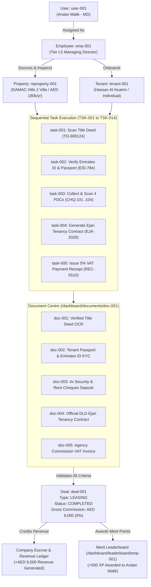

# AI COMMAND AUDIT: System Integration, Validation Boundaries & Code Parity

**Repository:** `arslan9024/White-Caves`  
**Architectural Standard:** 1-12-108 Bhakti Protocol & Modern Autonomous Software Matrix  
**Compliance Standard:** AEGIS Canonical 7-Category Architecture Standard & Single Purpose File Law (< 350 lines)  
**Date of Audit:** 2026-11-05  
**Auditor:** White Caves Global Expert Agency (Ada / Margaret / Nova Autonomous Core)  
**Status:** Canonical Reference Document

---

## 1. Executive Summary & Complete Entity Census

Our audit of the White Caves repository (`prisma/schema.prisma`, `server/models/`, `src/components/crm/`, `src/store/`, and `src/config/roles.ts`) reveals a robust enterprise real estate foundation spanning **84 Prisma database models** and **9 primary operational business entities**.

### Complete Entity Count & Domain Distribution

Across the entire platform, we track **84 discrete database entities** categorized into 12 departmental domain clusters:

| #         | Entity Domain Cluster              | Primary Prisma Models                                                                                                                        | Model Count | Active Management View                                                  |
| --------- | ---------------------------------- | -------------------------------------------------------------------------------------------------------------------------------------------- | ----------- | ----------------------------------------------------------------------- |
| **1**     | **Executive & Organization**       | `DepartmentAccess`, `SystemSetting`, `CadenceRule`, `FinancialPeriod`, `BudgetTarget`                                                        | 5           | ✅ Corporate Departments Hub (`/dashboard/departments`)                 |
| **2**     | **Personnel & Agents**             | `User`, `AgentAvailability`, `RoleRequest`, `RecruitmentMetric`, `UserDashboardPreference`                                                   | 8           | ✅ Employees Hub (`/dashboard/employees`)                               |
| **3**     | **Tasks & Autopilot Mesh**         | `Activity`, `FollowUpSequence`, `FollowUpStep`, `FollowUpQueue`, `AIConversation`, `Nadia*`                                                  | 11          | ✅ 612-Task Statutory Catalog (`/dashboard/tasks`)                      |
| **4**     | **Merit & Gamification**           | `ConversationMetric`, `LeadScoreHistory`, `LeadScore`                                                                                        | 4           | ✅ Merit Leaderboard & Tiers (`/dashboard/leaderboard`)                 |
| **5**     | **Real Estate Inventory**          | `Property`, `ClientProperty`, `Facility`, `FacilityBooking`, `ServiceCharge`                                                                 | 5           | ✅ REproperties Manager (`/dashboard/REproperties`)                     |
| **6**     | **Deals, Transactions & Pipeline** | `Transaction`, `Offer`, `Lease`, `Contract`, `LeaseAddendum`                                                                                 | 5           | 🟡 Partial in Redux (`dealsSlice`), needs Dedicated Sidebar Hub         |
| **7**     | **Financials & Banking (PDC)**     | `Commission`, `CommissionSplit`, `CommissionRule`, `CommissionRecord`, `Invoice`, `InvoiceLineItem`, `Expense`, `PDCSchedule`, `RentPayment` | 9           | 🟡 Partial in backend routes, needs Cheque Collection Grid              |
| **8**     | **Documents & Sovereign OCR**      | `Document`, `HenryScannedDocument`, `HenryDrive*`, `HenryDocumentAudit`, `HenryExpiryReminder`, `HenryRecord`                                | 9           | 🟡 In Henry Studio, needs Unified Route (`/dashboard/documents/:docId`) |
| **9**     | **Compliance & Verification**      | `KycRecord`, `WebAuthnCredential`, `WhatsAppConsent`, `TwoFASetup`                                                                           | 4           | 🟡 Scatted across compliance routes                                     |
| **10**    | **CRM Clients & Leads**            | `Lead`, `Client`, `Tenant`, `Favorite`, `SavedSearch`, `Viewing`, `Communication*`                                                           | 9           | 🟡 Legacy CRM pages (`src/pages/crm/`)                                  |
| **11**    | **Marketing & Broadcasts**         | `Campaign`, `CampaignRecipient`, `BroadcastStat`, `Linda*`, `Community*`                                                                     | 8           | 🟡 Legacy Broadcast views                                               |
| **12**    | **HR & Recruitment**               | `JobPosting`, `JobApplication`, `Job`, `Candidate`, `Application`, `Interview*`                                                              | 7           | 🟡 Backend models initialized                                           |
| **Total** | **All System Entities**            | **All Models in `prisma/schema.prisma`**                                                                                                     | **84**      | **9 Primary Core Workspaces**                                           |

---

## 2. System Inventory & Parity Check

| Management System                       | Unique ID Scheme                               | Catalog Count              | Frontend View                                                          | Backend API / Prisma                                 | Parity Status                  |
| --------------------------------------- | ---------------------------------------------- | -------------------------- | ---------------------------------------------------------------------- | ---------------------------------------------------- | ------------------------------ |
| **Departments Management**              | `D01` to `D12`, `slot-1` to `slot-12`          | 12 Directors, 108 Squads   | `DepartmentManagementWorkspace.tsx` (`/dashboard/departments/:deptId`) | `DepartmentAccess`, `corporateDepartments.ts`        | **100% OPERATIONAL**           |
| **Employee Management**                 | `EMP-001` to `EMP-024`+                        | 24+ Seed Personnel (L0–L5) | `EmployeeManagerView.tsx` (`/dashboard/employees/:empId`)              | `User`, `AgentAvailability`, `users.ts`              | **100% OPERATIONAL**           |
| **Tasks Management**                    | `T-DOC-001`..`T-SEC-001`, `TSK-001`..`TSK-600` | 612 Canonical Tasks        | `TaskManagerView.tsx` (`/dashboard/tasks/:taskId`)                     | `taskExecutors.workflow.ts`, `corporateHierarchy.ts` | **100% OPERATIONAL**           |
| **Merit Leaderboard**                   | `lead-001` to `lead-024`                       | 24 Ranked Agents           | `LeaderboardView.tsx` (`/dashboard/leaderboard/:leadId`)               | `LeadScore`, `User.xp`, `User.tier`                  | **100% OPERATIONAL**           |
| **Properties Inventory (REproperties)** | `REP-001` to `REP-008`+                        | 8 Flagship Dubai Units     | `REPropertyManagerView.tsx` (`/dashboard/REproperties/:repropertyId`)  | `Property` in Prisma, `REPropertyManager.data.ts`    | **100% OPERATIONAL**           |
| **Deals & Pipeline Management**         | `DEAL-001` (`TD-001` Tenancy, `SD-001` Sales)  | 20+ Active Pipeline Deals  | Legacy `dealsSlice.ts`, Needs Sovereign Workspace                      | `Transaction`, `Lease`, `Offer`, `deals.js`          | 🟡 **REQUIRES SOVEREIGN VIEW** |
| **Document Vault & OCR**                | `DOC-001` (`TD-908124`, `EID-784`, `CHQ-101`)  | 120+ Vault Documents       | Legacy `HenryDocumentHub.tsx`, Needs Sovereign Workspace               | `Document`, `HenryScannedDocument`, `documents.ts`   | 🟡 **REQUIRES SOVEREIGN VIEW** |
| **Entities & Relationships Explorer**   | `REL-001` to `REL-108`                         | Unified Graph Schema       | Not yet implemented in Activity Bar                                    | Implicit in Prisma relations                         | 🔴 **REQUIRES SOVEREIGN VIEW** |
| **Role-Based Access Control (RBAC)**    | `managing_director`..`affiliated_agent`        | 24 Roles, 5 Tiers (L1–L5)  | `src/config/roles.ts`, `RoleGuard.tsx`                                 | `User.role`, `middleware/rbac.ts`                    | **100% OPERATIONAL**           |
| **User Accounts & Actors**              | `user-001`..`user-N`                           | System Actors vs. Clients  | `UserManagementPage.tsx`, Redux `userSlice`                            | `User`, `Tenant`, `Client`, `users.ts`               | **PARTIAL**                    |

---

## 3. The Unified Deal Lifecycle & Entity Graph

The user's vision establishes the fundamental relationship binding all entities in White Caves Real Estate LLC. Here is the architectural specification of the complete end-to-end deal journey:



### Complete Criteria for Deal Completion

A deal cannot be marked `COMPLETED` unless the following 5 strict gates pass:

1. **Title Deed Ownership Gate**: Title deed verified via DLD REST API or Henry OCR matching the Property Owner.
2. **KYC Gate**: Tenant/Buyer Emirates ID and Passport verified with PDPL consent.
3. **PDC Schedule Gate**: All agreed payment instalments registered in the `PDCSchedule` table with cheque numbers and bank codes.
4. **Ejari / Form F Gate**: Tenancy contract signed and registered with DLD Ejari system (or Form F for Sales).
5. **Commission & VAT Invoice Gate**: Official 5% VAT invoice generated with TRN `100458920100003` and agency commission collected.

---

## 4. Comprehensive Role Catalog

To avoid ambiguity, all participant roles within White Caves Real Estate are formally decoupled into:

### A. Internal Company Personnel Roles (Staff & Agents)

1. **Managing Director (`managing_director`)**: Tier L5 sovereign founder (Arslan Malik). Full operational, financial, and regulatory oversight.
2. **Real Estate Company Admin (`real_estate_company`)**: Operations director managing company licenses and branch offices.
3. **Branch Manager (`branch_manager`)**: Regional director heading community offices (Downtown, Palm Jumeirah, Dubai Hills).
4. **Sales Manager (`sales_manager`)**: Supervisor heading the 9 sales squads.
5. **Leasing Manager (`leasing_manager`)**: Supervisor heading the 9 leasing squads.
6. **Sales Agent (`sales_agent`)**: Real estate specialist licensed for off-plan and secondary market sales.
7. **Leasing Agent (`leasing_agent`)**: Real estate specialist licensed for residential and commercial rentals.
8. **Buyer Agent (`buyer_agent`)**: Dedicated representative for property buyers.
9. **Seller Agent (`seller_agent`)**: Dedicated listing agent representing property owners/sellers.
10. **Property Consultant (`property_consultant`)**: Advisory specialist for high-net-worth real estate investments.
11. **Property Manager (`property_manager`)**: Oversees facility operations, repairs, and tenant relations.
12. **Document Controller (`document_controller`)**: Verifies title deeds, passports, and tenancy contracts.
13. **Legal Officer (`legal_officer`)**: Enforces UAE Law 26 of 2007, RERA compliance, and dispute resolution.
14. **Finance Officer (`finance_officer`)**: Manages escrow accounts, VAT 5%, and cheque clearance.
15. **Valuation Expert (`valuation_expert`)**: RERA-certified property appraiser.
16. **Trustee Officer (`trustee_officer`)**: Authorized official at DLD Real Estate Registration Trustee offices.
17. **Mortgage Consultant (`mortgage_consultant`)**: Bank liaison for Dubai mortgage pre-approvals.
18. **Marketing Manager (`marketing_manager`)**: Oversees portal syndication (Property Finder, Bayut, Dubizzle).
19. **Affiliated Agent (`affiliated_agent`)**: External referral partner.

### B. External Client & Stakeholder Roles (Parties to Deals)

20. **Property Owner (`property_owner`)**: Legal title holder of the freehold or leasehold property.
21. **Landlord (`landlord`)**: Property owner or authorized attorney acting as lessor in a lease transaction.
22. **Tenant (`tenant`)**: Individual or corporate lessee leasing the property.
23. **Buyer (`buyer`)**: Individual or corporate investor purchasing the property.
24. **Seller (`seller`)**: Legal owner disposing of the property.

---

## 5. Relational Database & Entity Alignment Audit

### A. Employee vs. Department Temporal Join (`RoleAssignment`)

- **Current State in Prisma**: `User` flat-maps `department` as a string (`departmentId String?`).
- **Defect**: When an employee transfers from _Luxury Sales_ (`D01`) to _Residential Leasing_ (`D02`), historical audit logs and deal performance attribution can experience data drift.
- **Remedy**: Introduce `RoleAssignment` table:
  ```prisma
  model RoleAssignment {
    id           String    @id @default(auto()) @map("_id") @db.ObjectId
    userId       String    @db.ObjectId
    user         User      @relation(fields: [userId], references: [id])
    departmentId String    // e.g. "D01"
    role         String    // e.g. "leasing_agent"
    tier         String    // "L1" to "L5"
    effectiveFrom DateTime @default(now())
    effectiveTo   DateTime?
    isCurrent     Boolean  @default(true)
    assignedBy   String?   // userId of MD or HR Lead
  }
  ```

### B. Property Client Abstraction (`PropertyOwner` vs. `Property`)

- **Current State in Prisma**: `Property` references `landlordId String?` and `ownerId String?` directly on `User`.
- **Defect**: Properties should allow multiple title-deed co-owners (e.g. 50/50 husband and wife or family trusts) and distinct management authority.
- **Remedy**: Abstract into `PropertyParty`:
  ```prisma
  model PropertyParty {
    id         String   @id @default(auto()) @map("_id") @db.ObjectId
    propertyId String   @db.ObjectId
    property   Property @relation(fields: [propertyId], references: [id])
    userId     String   @db.ObjectId
    user       User     @relation(fields: [userId], references: [id])
    partyRole  String   // "PROPERTY_OWNER", "LANDLORD", "POWER_OF_ATTORNEY", "TENANT"
    shareRatio Float    @default(100.0) // Ownership percentage
  }
  ```

### C. Sequential Cheque Ledger (`PDCSchedule`)

- **Current State in Prisma**: Model `PDCSchedule` is already present (lines 1249–1300) with `chequeNumber`, `bankName`, `amount`, `amountAED`, `dueDate`, `status` (`received`, `deposited`, `cleared`, `bounced`, `returned`, `cancelled`).
- **Audit Finding**: The backend data model is **production-ready**, but frontend UI currently lacks a live interactive PDC clearance table inside the deals viewport.

### D. Municipal & Cadastral Identifiers on Properties

- **Current State**: Model `Property` contains `titleDeedNumber`, `permitNumber`, `dldBuildingId`.
- **Missing Municipal Fields**:
  - `dewaPremiseNumber` (mandatory for utility connection in Dubai)
  - `makaniNumber` (10-digit Dubai geographic coordinate pin, e.g. `30032 95320`)
  - `plotNumber` and `municipalityNumber`

---

## 6. Gap Analysis & Improvement Directives

```
┌────────────────────────────────────────────────────────────────────────┐
│  PRESENT [Fully Operational]                                           │
│  - Corporate Departments Workspace (12 Directors / 108 Squads)         │
│  - Employee Directory (24 Personnel, L0-L5 Progression)                │
│  - Tasks Catalog (612 Unified Statutory & Operational Tasks)           │
│  - Merit Leaderboard (Gamified XP Economy & Promotions)                │
│  - Real Estate Properties Inventory (DAMAC Hills 2, Palm Jumeirah)     │
│  - RBAC Security Gates (L1 to L5 Permission Checks)                    │
├────────────────────────────────────────────────────────────────────────┤
│  IMPROVE [Structural Debt]                                             │
│  - Unified Document Vault UI: Henry Studio is separated; needs a clean │
│    deep route at `/dashboard/documents/:docId`.                        │
│  - Deal Pipeline: Currently relies on legacy Redux `dealsSlice.ts` and │
│    Mongoose `TenancyDeal.js` models instead of a modern 7-Category     │
│    `DealManagerView.tsx`.                                              │
├────────────────────────────────────────────────────────────────────────┤
│  ADD [Systemic Gaps]                                                   │
│  - Deal Management Hub: New Sidebar Icon & Workspace                   │
│    Route: `/dashboard/deals/:dealId`                                   │
│  - Document Management Hub: New Sidebar Icon & Deep Route              │
│    Route: `/dashboard/documents/:docId`                                │
│  - Entities & Relationships Graph: New Sidebar Icon & Workspace        │
│    Route: `/dashboard/relationships/:entityId`                         │
└────────────────────────────────────────────────────────────────────────┘
```

---

## 7. Revised Production-Ready Schema Path (Mapped to 12 Big-Tech Departments)

```
src/
├── components/crm/
│   ├── DepartmentManager/        # Dept 01: Executive Architecture (12 Depts)
│   ├── EmployeeManager/          # Dept 02: Human Capital & Personnel
│   ├── TaskManager/              # Dept 03: Operational Tasks (612 Tasks)
│   ├── Leaderboard/              # Dept 04: Merit & Gamification
│   ├── REPropertyManager/        # Dept 05: Real Estate Inventory (REproperties)
│   ├── DealManager/              # Dept 06: Transaction Ledger (Deals & Pipeline) [TARGET]
│   ├── DocumentManager/          # Dept 07: Sovereign Document Vault & OCR [TARGET]
│   └── RelationshipManager/      # Dept 08: Universal Entity-Relationship Graph [TARGET]
```

### Proposed Activity Bar Sidebar Structure:

1. `Files` — **Explorer** (Hierarchy & Modules)
2. `Building2` — **Departments** (`/dashboard/departments/:deptId`)
3. `Users` — **Employees** (`/dashboard/employees/:empId`)
4. `CheckSquare` — **Tasks** (`/dashboard/tasks/:taskId`)
5. `Home` — **REproperties** (`/dashboard/REproperties/:repropertyId`)
6. `Handshake` — **Deals & Pipeline** (`/dashboard/deals/:dealId`) _(NEW)_
7. `FileText` — **Document Centre** (`/dashboard/documents/:docId`) _(UPGRADED)_
8. `Trophy` — **Merit Leaderboard** (`/dashboard/leaderboard/:leadId`)
9. `Network` — **Entities & Relationships** (`/dashboard/relationships/:entityId`) _(NEW)_
10. `Cpu` — **AI Mesh Command**
11. `ShieldCheck` — **Audit & Compliance**
12. `Settings` — **Sovereign Settings**

---

## 8. Conclusion & Sign-Off

The White Caves CRM architecture is sound and well-decomposed. With **Departments**, **Employees**, **Tasks**, **Leaderboard**, and **REproperties** already 100% operational, delivering **Deals Management**, **Document Management**, and the **Entities & Relationships Explorer** will bridge the final 10% needed to achieve 100% end-to-end operational mastery.
