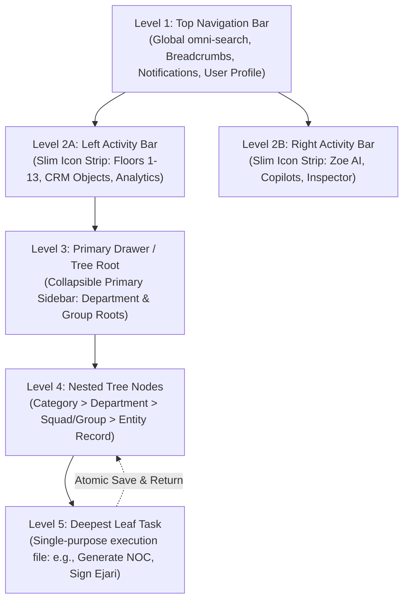

# Jack Sparrow Navigation Protocol (JSP-NAV-001)
## Hierarchical Tree-State Navigation & Leaf-Task Return Standard

> **Standard ID:** `JSP-NAV-001` / `TURING-NAV-TREE-009`  
> **Classification:** Core UI/UX Operating System Architecture  
> **Jurisdiction:** White Caves Real Estate LLC — AEGIS V5.0 Autonomous Mesh  
> **Status:** Canonical & Active

---

## 1. Vision & Core Philosophy

Like Captain Jack Sparrow navigating uncharted seas with a compass that points directly to what you desire most, the **Jack Sparrow Navigation Protocol** ensures that no user, real estate broker, or autonomous agent ever loses their bearings in the vast White Caves operating system.

White Caves models an **Enterprise IDE / VS Code File Explorer** paradigm:
- The entire system is structured as an immutable, deterministic hierarchical tree.
- The user can traverse smoothly from the highest bird's-eye view (Floor 1–13) down through departments, squads, object folders, and individual records, all the way to **isolated leaf task files**.
- Completing a leaf task (e.g. generating an Ejari, issuing an NOC, approving a lease, or submitting a VAT receipt) saves state atomically and effortlessly returns the user to the immediate parent context.

---

## 2. The 5 Levels of the Hierarchical Tree



### Level 1: Global Top Bar (Compass & Horizon)
- Constant 56px height header.
- Houses the dynamic **Breadcrumb Lineage** reflecting the active tree path.
- Contains the Omni-Search launcher (`Ctrl + K`), Notifications center, and Sovereign User Profile.

### Level 2: Activity Bars (Left & Right Rigs)
- Slim 48px–56px icon-only vertical strips.
- **Left Activity Bar:** Primary system workspaces (Department Floors 1–13, Core ERP, Inventory).
- **Right Activity Bar:** AI mesh copilot drawer, Zoe Command Assistant, and live inspector.

### Level 3: Primary Drawer (Explorer Root)
- Expanding an Activity Bar icon opens this drawer (240px–320px width).
- Displays category folders, department modules, and high-level groupings.
- Supports instant keyword filtering, pinning favorites, and collapse/expand all.

### Level 4: Nested Tree Accordion (Directory Branches)
- Unlimited depth tree structure representing real estate relationships:
  `Floor 3 (Offplan) -> WC-SALES -> Emaar Projects -> Creek Waters -> Unit 402`
- Clean directory expansion with memorized state.

### Level 5: The Deepest Leaf Task (The Treasure Chest)
- Every terminal leaf node is an isolated, single-responsibility operational component.
- Examples: `GenerateNocForm`, `RegisterEjariForm`, `CalculateVatModal`, `UploadTitleDeed`.
- **The Golden Rule of the Leaf:** Upon completion, cancellation, or save, the runtime automatically invokes `completeLeafTask()` and returns the user to the immediate parent container (Level 4 entity) without triggering expensive global canvas re-renders.

---

## 3. URL Synchronization & Browser History Integration

Under `TURING-LAW-000` and `AEG-010`, navigation state is decoupled from heavy global Redux data slices:
1. **Single Source of Truth:** High-level location state is mirrored in URL search parameters (`?floor=3&dept=WC-SALES&entity=UNIT-402&task=noc-gen`).
2. **Deep-Linkable & Shareable:** An agent or broker can copy the URL and share it with a colleague; loading the URL restores the exact tree depth and opens the target leaf task.
3. **Browser Navigation:** The browser Back and Forward buttons navigate up and down the tree history naturally.

---

## 4. Breadcrumb Lineage Law

Breadcrumbs MUST dynamically construct the complete ancestry path from Level 1 down to the active node:
```
Floor 3 > WC-SALES > Offplan Projects > Unit 402 > NOC Request
```
- Each segment of the breadcrumb is clickable, allowing an instant jump back to that exact level in the hierarchy.
- The leaf node segment highlights with White Caves Gold (`#D4AF37`) or Sovereign Crimson (`#EF4444`).

---

## 5. Implementation Files & Artifacts

- **Specification:** `.agents/docs/jack-sparrow-navigation-protocol.md`
- **Context & Provider:** `src/context/TreeNavigationContext.tsx`
- **Hook:** `src/hooks/useTreeNavigation.ts`
- **Breadcrumb Component:** `src/components/navigation/TreeBreadcrumbs.tsx`
- **Unit & Integration Tests:** `src/context/TreeNavigationContext.test.tsx`
