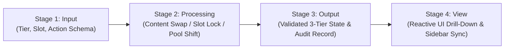

# SRS: Departments Hub 3-Tier Hierarchy & Workflow Engine Specification

> **Document ID:** `SRS-CRM-DEPT-HUB-001`  
> **Version:** `1.0.0 (Bhakti Protocol / 7-Category Architecture)`  
> **Status:** APPROVED & ACTIVE  
> **Authority:** White Caves Real Estate LLC — Global Sovereign AI Grid

---

## 1. Executive Summary & Architectural Overview

The **Departments Hub** provides the operational nerve center of White Caves Real Estate under the **Bhakti Protocol (1 Sovereign Core | 12 Corporate Departments | 108 Engineering/Operational Nodes)**.

The system enforces a strict 3-tier organizational hierarchy:

1. **Tier 1 (Strategic Leadership):** **12 Corporate Departments** overseen by **12 Department Directors** (Fixed positions #1 to #12, Canonical Codes `DEPT-01` to `DEPT-12`).
2. **Tier 2 (Tactical Operations):** **9 Division / Sub-Department Managers** per department (Fixed positions #1 to #9, Canonical Codes `MGR-01` to `MGR-09`), representing the 9 most critical operational task domains of that department.
3. **Tier 3 (Execution Core):** **Multiple Operational Teams** under each Division Manager, where each team is commanded by one dedicated **Supervisor** (Codes `SUP-01`..., mapping to the 108 Supervisors and specialist units).

---

## 2. Core Functional Requirements

### 2.1 Fixed Slot Invariant & Bhakti Protocol Position Locking

- **Position Immutability:** Slot indices (`#1` to `#12` for Directors, `#1` to `#9` for Managers, and sequential team slots for Supervisors) and canonical codes (`DEPT-01`–`DEPT-12`, `MGR-01`–`MGR-09`, `SUP-01`...) NEVER change or shuffle during reordering.
- **Content Swapping:** When a user drags and drops between two slots at any tier, only the underlying node contents (title, assigned person, scope, kpis, metadata) are swapped. The structural slot coordinates remain permanently locked.

### 2.2 Hierarchical CRUD Capabilities

Full Create, Read, Update, and Demote/Reassign operations across all 3 tiers:

- **Director CRUD (Tier 1):** Appoint director, update mandate, set departmental theme color/icon, demote to Unassigned Pool.
- **Division Manager CRUD (Tier 2):** Define manager role, assign operational task domain (out of 9), set SLA response time, demote to Unassigned Pool.
- **Supervisor Team CRUD (Tier 3):** Create operational team under a designated manager, assign supervisor specialist, specify capabilities and headcount, reassign team between managers, or demote to Unassigned Pool.

### 2.3 Zero-Delete Preservation Law (Demotion to Unassigned Pool)

- **Zero Data Loss:** No corporate department, division manager, team, or supervisor may ever be permanently deleted.
- **Automatic Demotion:** Triggering "delete" at any tier demotes the target entity into the **Unassigned Operational Reserve Pool** preserving all operational scope, historical metadata, and capabilities.
- **Instant Re-Appointment:** Any entity in the Unassigned Pool can be dragged back or promoted into any open or occupied slot at any tier.

---

## 3. Workflow Engine Specification (Universal 4-Stage I-P-O-V)

Every operation within the hierarchy operates via the **Department Hierarchy Workflow Engine** implementing the **I-P-O-V** pattern:

1. **Stage 1 (Input Guard):** Validates the action payload (`swap`, `demote`, `promote`, `create`, `update`, `reassignTeam`), checking tier boundaries and slot integrity.
2. **Stage 2 (Processing Engine):** Executes idempotent state transformation:
   - Preserves fixed codes and slot order numbers.
   - Handles displacement: if an occupied slot is assigned a pool item, the prior occupant is demoted to the Unassigned Pool.
3. **Stage 3 (Output Generation):** Generates immutable updated hierarchy map and persists updates to the Express/MongoDB backend.
4. **Stage 4 (View Synchronization):** Dispatches state updates to reactive context, drill-down breadcrumbs, and UI toasts.

---

## 4. 7-Category Architectural Co-Location Standard

| Layer           | Canonical File                    | Responsibility                                                                |
| --------------- | --------------------------------- | ----------------------------------------------------------------------------- |
| **1. View**     | `DepartmentHierarchyView.tsx`     | Pure JSX layout: 12 Directors grid, 9 Managers grid, Supervisor Teams deck    |
| **2. Logic**    | `DepartmentHierarchy.logic.ts`    | Custom hook for 3-tier drill-down, active focus tracking, and drawer handlers |
| **3. Styles**   | `DepartmentHierarchy.styles.ts`   | Styled-components, tier badges (L1/L2/L3), responsive grids, slot cards       |
| **4. Data**     | `DepartmentHierarchy.data.ts`     | Canonical seed data for 12 Directors, 9 Managers each, and Supervisor teams   |
| **5. Config**   | `DepartmentHierarchy.types.ts`    | TypeScript interfaces for 3-tier nodes, action payloads, and CRUD forms       |
| **6. Tests**    | `DepartmentHierarchy.test.tsx`    | Vitest test suite for 3-tier hierarchy, I-P-O-V workflow, and drag-and-drop   |
| **7. Workflow** | `DepartmentHierarchy.workflow.ts` | Pure I-P-O-V workflow engine for hierarchical operations and pool transitions |

---

## 5. Compliance & Single Purpose File Law

- **Line Limit:** Every file in this implementation MUST stay strictly under **350 lines of code**.
- **AEGIS Governance:** Audited and verified via `npm run check:limits`.
