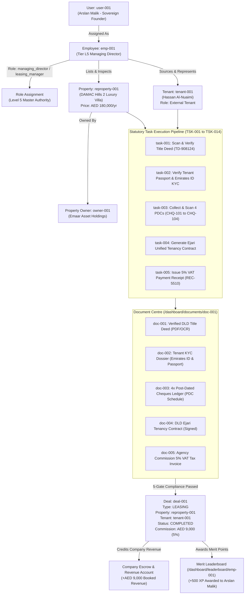

# White Caves Real Estate LLC - Unified Deal & Relationship Architecture Model

**Canonical Specification:** Architecture Standard 1-12-108 & Bhakti-Turing Dual Foundation  
**Version:** 1.0.0  
**Date:** 2026-11-05  
**Author:** White Caves Global Expert Agency (Ada / Margaret / Nova Autonomous Core)  
**Security Level:** L5 Sovereign MD Operational Governance

---

## 1. Core Architectural Principle

In the White Caves Real Estate sovereign platform, operational tasks are never disconnected administrative chores. Every entity—from an individual user account to an AI supervisor—is bound together in a deterministic, transaction-generating graph where the completion of sequential statutory tasks unlocks deal progression, triggers escrow collections, collects commission, and awards merit XP.



---

## 2. Complete Taxonomy of 24 Canonical Real Estate Roles

All roles within White Caves Real Estate are strictly separated into **19 Internal Company Personnel Roles** (employees, agents, managers) and **5 External Deal Counterparty Roles** (clients, buyers, tenants, owners).

### A. Internal Company Personnel Roles (19 Roles)

Under the L5 Managing Director governance model, every employee account has a specific operational scope:

| #   | Role Identifier       | Display Name              | Level  | Core Operational Scope                                                               |
| :-- | :-------------------- | :------------------------ | :----- | :----------------------------------------------------------------------------------- |
| 1   | `managing_director`   | Managing Director         | **L5** | Full sovereign authority; company-wide settings, approvals, finances, and audit.     |
| 2   | `real_estate_company` | Real Estate Company Admin | **L5** | Oversees branch compliance, trade licensing, and cross-departmental operations.      |
| 3   | `branch_manager`      | Branch Manager            | **L4** | Directs local community office operations (Downtown, Palm Jumeirah, Dubai Hills).    |
| 4   | `sales_manager`       | Sales Manager             | **L4** | Supervises sales agents, approves Form F contracts, and monitors pipeline targets.   |
| 5   | `leasing_manager`     | Leasing Manager           | **L4** | Supervises leasing agents, approves Ejari submissions, and monitors vacancy rates.   |
| 6   | `sales_agent`         | Sales Agent               | **L3** | Sources buyers/sellers, manages listings, conducts viewings, and submits Form B/F.   |
| 7   | `leasing_agent`       | Leasing Agent             | **L3** | Sources tenants/landlords, arranges rental viewings, collects PDCs, registers Ejari. |
| 8   | `buyer_agent`         | Buyer Agent               | **L3** | Exclusive buyer representation, property search matching, and offer negotiations.    |
| 9   | `seller_agent`        | Seller Agent              | **L3** | Exclusive seller listing representative, marketing syndication, open houses.         |
| 10  | `property_consultant` | Property Consultant       | **L3** | High-net-worth real estate portfolio optimization and investment advisory.           |
| 11  | `property_manager`    | Property Manager          | **L3** | Facilities maintenance, move-in/move-out condition inspections, rent collection.     |
| 12  | `document_controller` | Document Controller       | **L2** | Title deed verification, passport/visa checks, and Henry OCR quality auditing.       |
| 13  | `legal_officer`       | Legal Officer             | **L3** | Enforces UAE Law 26 of 2007, RERA dispute escalation, and contract terms.            |
| 14  | `finance_officer`     | Finance Officer           | **L3** | Manages escrow accounts, VAT 5% filing, commission disbursements, PDC banking.       |
| 15  | `valuation_expert`    | Valuation Expert          | **L3** | RERA-certified property valuation, comparative market analysis (CMA).                |
| 16  | `trustee_officer`     | Trustee Officer           | **L3** | Direct liaison with Dubai Land Department Real Estate Registration Trustee offices.  |
| 17  | `mortgage_consultant` | Mortgage Consultant       | **L3** | Bank liaisons, mortgage pre-approvals, and financing feasibility calculations.       |
| 18  | `marketing_manager`   | Marketing Manager         | **L3** | Portal syndication (Property Finder, Bayut, Dubizzle) and campaign tracking.         |
| 19  | `affiliated_agent`    | Affiliated Agent          | **L2** | External licensed broker sharing commissions on co-brokered transactions.            |

### B. External Deal Counterparty Roles (5 Roles)

These roles represent external participants in real estate transactions. They log into dedicated client portals and hold party ownership in contracts:

| #   | Role Identifier  | Display Name   | Category   | Transaction Responsibilities                                                     |
| :-- | :--------------- | :------------- | :--------- | :------------------------------------------------------------------------------- |
| 20  | `property_owner` | Property Owner | **Client** | Legal title deed holder registered with Dubai Land Department.                   |
| 21  | `landlord`       | Landlord       | **Client** | Lessor party to a tenancy contract (either owner or Power of Attorney holder).   |
| 22  | `tenant`         | Tenant         | **Client** | Lessee occupying property under registered Ejari contract; issues rental PDCs.   |
| 23  | `buyer`          | Buyer          | **Client** | Purchaser party in a sales transaction executing Form F (MOU) purchase contract. |
| 24  | `seller`         | Seller         | **Client** | Vendor party disposing of freehold or leasehold property via Form A listing.     |

---

## 3. Deal Lifecycle State Machine & 5 Strict Verification Gates

Every deal proceeds through 6 sequential phases. A deal cannot transition to `COMPLETED` without passing all 5 verification gates:

```
[ INQUIRY ] ──> [ VIEWING_SCHEDULED ] ──> [ OFFER_SUBMITTED ] ──> [ CONTRACT_PREPARATION ] ──> [ EJARI_SUBMITTED ] ──> [ COMPLETED ]
     │                   │                      │                         │                         │                    ▲
     ▼                   ▼                      ▼                         ▼                         ▼                    │
 Gate 1: Title Deed  Gate 2: Client KYC     Gate 3: Offer Terms       Gate 4: PDC Cheques      Gate 5: Ejari / Form F   All Passed
```

1. **Gate 1 (Title Deed Ownership)**:
   - DLD Title Deed number verified via REST API / Henry OCR against property owner's Emirates ID / Passport.
2. **Gate 2 (Client KYC & AML)**:
   - Client Passport, Emirates ID, and Visa scanned and verified with UAE PDPL privacy consent.
3. **Gate 3 (Offer Acceptance)**:
   - Written offer agreed between buyer/seller or tenant/landlord with security deposit pledged.
4. **Gate 4 (PDC Cheque Register)**:
   - All rental instalments entered into `PDCSchedule` with cheque numbers, bank clearing codes, and due dates.
5. **Gate 5 (Statutory DLD Registration)**:
   - Ejari registration certificate uploaded for leasing, or DLD Form F signed for sales transactions.
   - 5% VAT Tax invoice generated with company TRN `100458920100003`.

---

## 4. Deep URL Routing Matrix

| Entity            | Deep Link URL                           | Primary Key              | Modal / Drawer Action                            |
| :---------------- | :-------------------------------------- | :----------------------- | :----------------------------------------------- |
| **Departments**   | `/dashboard/departments/:deptId`        | `D01` to `D12`           | Opens 9 Division Managers & Squads modal.        |
| **Employees**     | `/dashboard/employees/:empId`           | `EMP-001` to `EMP-024`   | Opens Career Dossier & Role Assignment drawer.   |
| **Tasks**         | `/dashboard/tasks/:taskId`              | `TSK-001` to `TSK-600`   | Opens 4-Stage Task Execution Workbench.          |
| **Properties**    | `/dashboard/REproperties/:repropertyId` | `REP-001` to `REP-008`   | Opens Property Inspection & Title Deed modal.    |
| **Deals**         | `/dashboard/deals/:dealId`              | `DEAL-001` to `DEAL-020` | Opens Deal Pipeline, PDC Ledger & Escrow modal.  |
| **Documents**     | `/dashboard/documents/:docId`           | `DOC-001` to `DOC-120`   | Opens Document Viewer, OCR metadata & KYC modal. |
| **Leaderboard**   | `/dashboard/leaderboard/:leadId`        | `EMP-001` to `EMP-024`   | Opens Agent XP History & Promotion drawer.       |
| **Relationships** | `/dashboard/relationships/:entityId`    | `REL-001` to `REL-108`   | Opens Interactive Graph Explorer for the node.   |

---

## 5. Architectural Law: Single Purpose File Standard

All implementation components adhering to this model must strictly comply with:

- **File Length Ceiling**: Maximum 350 lines per file (< 350 lines).
- **Separation of Concerns**: Views (`*.tsx`), Logic (`*.logic.ts`), Styles (`*.styles.ts`), Static Data (`*.data.ts`), Types (`*.types.ts`), Tests (`*.test.tsx`), Workflows (`*.workflow.ts`).
- **Non-Destructive Mutations**: Entities are archived (`OFF_MARKET`, `CANCELLED`, `ARCHIVED`) rather than hard-deleted.
