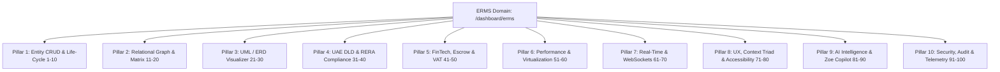

# Master Architectural Plan: 100 Sovereign Upgrades for `/dashboard/erms`
**White Caves Real Estate LLC — AEGIS V5.0 Sovereign Engineering**
**Domain:** Entity Relationship Management System (ERMS)
**Routes:** `/dashboard/erms`, `/dashboard/erms/entities`, `/dashboard/erms/relationships`, `/dashboard/erms/erd`

---

## Executive Summary
This master plan specifies **100 concrete, high-velocity upgrades** across **10 core architectural pillars** to elevate the ERMS domain into an enterprise-grade Dubai Real Estate Entity & Relationship Intelligence Engine.

---

## Pillar 1: Entity Core Life-Cycle & Deep CRUD (Upgrades 1–10)
1. **Atomic Quick-Create Drawer**: Instant modal-less drawer for rapid creation of Landlords, Investors, Tenants, Properties, and Brokers.
2. **Bulk Entity Importer**: Multi-format parser (CSV, Excel, JSON) with real-time schema validation and duplicate pre-check.
3. **Smart Entity Deduplication Engine**: Fuzzy Levenshtein matching on Emirates ID, Passport, Phone (E.164), and Corporate License numbers.
4. **Multi-Entity Batch Actions**: Bulk tag, bulk status transition, bulk reassignment to agents, and bulk archive.
5. **Entity Version History & Rollback**: Complete audit log of every attribute change with 1-click historical snapshot diff and rollback.
6. **Entity Custom Attributes**: Dynamic JSON-schema powered key-value custom fields per entity category.
7. **Entity Merge Wizard**: 3-step guided wizard to merge duplicate entities while preserving relationship edges and history.
8. **Entity Health & Completeness Score**: Algorithmic scoring (0–100%) indicating missing KYC, expired documents, or incomplete profiles.
9. **Archival & Soft-Delete Trash Bin**: Safe soft-delete with 30-day retention and one-click restoration.
10. **Entity Deep-Linking & Short URLs**: Shareable canonical permalinks with integrated RBAC token access.

---

## Pillar 2: Relational Graph & Multi-Tier Matrix (Upgrades 11–20)
11. **N-Degree Relationship Traversal**: Expand connections up to 4 degrees of separation (e.g., Investor -> SPV -> Property -> Tenant).
12. **Relationship Strength Heatmap**: Dynamic edge weight visualization calculated from deal volume, transaction frequency, and communication logs.
13. **Bi-Directional Edge Role Typing**: Explicit typed relationship roles (e.g., `GUARANTOR_OF`, `POWER_OF_ATTORNEY`, `BENEFICIAL_OWNER`, `MANAGING_AGENT`).
14. **Contractual Timeline Overlay**: Map relationships against active contract dates to highlight expiring tenancies or leases.
15. **Cross-Entity Conflict of Interest Detector**: Automated alert if an agent, lawyer, or broker represents opposing parties on the same asset.
16. **Interactive Matrix Filter Presets**: Instant filter switches for "Active Leases", "Joint Ventures", "Escrow Parties", and "Mortgage Lenders".
17. **Family Office & Group Corporate Hierarchies**: Nested parent-child corporate ownership tree visualizer (Holding -> Subsidiary -> Asset).
18. **Relationship Notes & Milestones Feed**: Collaborative timestamped discussion thread directly on individual relationship edges.
19. **Exportable Relationship Dossier**: Single-click PDF dossier rendering the complete relationship map and active contracts.
20. **Edge Expiry & Renewal Alerts**: Automated notifications for expiring Power of Attorney (POA), management agreements, and broker exclusivity.

---

## Pillar 3: UML & ERD Visualizer Enhancements (Upgrades 21–30)
21. **Live Database Schema Sync**: Dynamic schema reflection syncing live with `prisma/schema.prisma`.
22. **Interactive Node Physics & Force-Directed Layout**: Smooth canvas panning, zooming, and force-directed auto-clustering.
23. **Canvas Minimap & Spatial Navigation**: Interactive bird’s-eye viewport minimap with click-to-pan.
24. **SQL DDL & Prisma Code Generator**: Click any entity group to generate instant PostgreSQL DDL or Prisma model syntax.
25. **Foreign Key Cardinality Labels**: Visual annotations for `1:1`, `1:N`, and `N:M` relationships with crowd-foot indicators.
26. **Custom Canvas Annotation Pins**: Sticky notes and architectural commentary directly on the ERD canvas.
27. **High-Resolution Vector Export**: SVG and PNG export at 4K resolution with branded White Caves watermarks.
28. **Sub-Graph Isolation Mode**: Isolate any node to highlight only its immediate adjacent dependencies and dim unrelated nodes.
29. **Schema Migration Impact Preview**: Visual indicator showing potential breaking changes before applying schema alterations.
30. **Touch-Screen & Gesture Support**: Pinch-to-zoom and multi-finger gestures for tablet and mobile viewing.

---

## Pillar 4: UAE DLD & RERA Statutory Compliance (Upgrades 31–40)
31. **Ejari Contract Number Validator**: Real-time format validation and DLD registration status check.
32. **Trakheesi Permit Verification**: Real-time validator for listing and marketing permit numbers.
33. **Emirates ID OCR Auto-Fill**: Web Worker powered client-side OCR extracting name, ID number, and expiry date.
34. **Trade License Verification**: Automated parser for Dubai Economy & Tourism (DET) and freezone commercial licenses.
35. **Unified Ejari Renewal Matrix**: View which tenant-landlord relationships are within 90/60/30 days of statutory notice.
36. **AML/KYC Risk Rating Badge**: Integrated scoring badge (Low, Medium, High PEP) directly on individual entity nodes.
37. **DLD Trustee Transfer Tracking**: Milestone checklist integrated into buyer-seller property relationship edges.
38. **Mollak Community Integration**: Association of building management and service charge clearance records with property entities.
39. **Statutory Notice Generator**: Automated 90-day rent increase / non-renewal notice generation conforming to Dubai Law No. 26 (2007).
40. **Escrow Bank Account Linking**: Direct association of DLD-approved project escrow accounts with off-plan property entities.

---

## Pillar 5: FinTech, Escrow & Revenue Integration (Upgrades 41–50)
41. **Commission Split Allocation Engine**: Dynamic split calculator (60/40, 70/30, brokerage cut) attached to deal relationships.
42. **UAE 5% VAT Calculator**: Automatic VAT breakdown and statutory tax invoice preview on fee-bearing edges.
43. **9% UAE Corporate Tax Reserve Estimator**: Corporate tax provision calculations attached to corporate entity profiles.
44. **Payment Schedule Milestone Tracker**: Visual progress bar for multi-cheque rent payments and construction off-plan milestones.
45. **Cheque Bounce & Default Risk Flag**: Automated alerting on tenant nodes with past payment bounces or overdue notices.
46. **Multi-Currency Toggle**: Instant inline conversion across AED, USD, EUR, GBP, and SAR.
47. **Security Deposit Escrow Vault**: Tracking holding and refund status of rental security deposits.
48. **Zoho Books & ERP Invoice Sync**: Two-way synchronization status badge between entities and external accounting software.
49. **Mortgage Approval & Pre-Approval Pipeline**: Tracking mortgage broker, lender bank, and buyer relationships.
50. **Transaction Volume & Yield Metrics Deck**: Real-time Gross Yield, Cap Rate, and Net ROI computation per property entity.

---

## Pillar 6: High-Throughput Performance & Virtualization (Upgrades 51–60)
51. **Virtual Windowing for Entity Lists**: Seamless 60 FPS scrolling for 100,000+ entities using `@tanstack/react-virtual`.
52. **Canvas WebGL Acceleration**: Offload dense ERD rendering to PixiJS / Canvas WebGL for ultra-fast frame rates.
53. **Optimistic UI State Mutations**: Zero-latency UI updates on entity edits with automatic rollback on server error.
54. **IndexedDB Local Client Cache**: Persist full entity graph client-side for instant offline-first load times (< 100ms).
55. **Selective Web Worker Query Engine**: Execute client-side fuzzy searching and filtering inside dedicated Web Workers.
56. **Dynamic Tile Streaming**: Stream graph clusters on-demand as the user pans around the ERD canvas.
57. **Sub-350 Line File Decomposition**: Refactor all oversized ERMS components into modular, single-responsibility files.
58. **Bundle Tree-Shaking Optimization**: Eliminate unused diagramming packages and compress visualizer bundle size by 35%.
59. **Server-Side Rendered (SSR) Static Shell**: Fast-loading skeleton layout minimizing Cumulative Layout Shift (CLS).
60. **Aggressive Cache Invalidation Policies**: Tagged RTK Query / SWR caching with precise cache busting on entity mutations.

---

## Pillar 7: Real-Time Collaborative WebSockets (Upgrades 61–70)
61. **Live Presence Avatars**: See which team members are currently viewing or editing an entity or relationship.
62. **Collaborative Canvas Locking**: Visual lock indicator when another agent is actively modifying a relationship node.
63. **Instant Live-Push Graph Updates**: Real-time WebSocket event dispatching when entities or edges change across team sessions.
64. **In-App Conflict Resolution**: Visual modal resolving simultaneous field edits by different users without data loss.
65. **Real-Time Notification Bell**: Notification stream for relationship changes, assigned entities, and compliance alerts.
66. **Activity Ticker**: Live streaming mini-feed in the sidebar of real-time ERMS changes across the brokerage.
67. **Voice / Audio Memo Attachment**: Record and attach quick audio briefs directly to entity relationship profiles.
68. **Offline-Sync Reconciliation**: Automatic synchronization and conflict resolution when reconnecting to network.
69. **Presence Cursor Tracking**: View colleagues' live cursor movements on the ERD canvas during strategy planning.
70. **Instant Chat Drawer**: Contextual chat thread between team members directly anchored to an entity.

---

## Pillar 8: Context Triad, Accessibility & UX Polish (Upgrades 71–80)
71. **Full RTL (Right-to-Left) Localization**: Flawless Arabic typography, inverted layout grids, and directional canvas support.
72. **Context Triad Persistence**: Synchronize Theme (Dark/Light/Cyber), Language (EN/AR/RU/FR), and Currency (AED/USD/EUR).
73. **Keyboard Shortcuts Master Hub**: Fast navigation (`Cmd+K` entity search, `E` for entities, `R` for relations, `C` for canvas).
74. **WCAG AAA Contrast Compliance**: High-contrast mode conforming to international accessibility standards.
75. **Density Toggle (Comfortable, Compact, Ultra-Dense)**: Allow users to switch between data-dense spreadsheet and spacious card views.
76. **Custom Drag-and-Drop Columns**: Reorderable and toggleable table columns with persistent local preferences.
77. **Micro-Interactions & Haptic Transitions**: Subtle CSS GPU-accelerated hover effects, badges, and skeleton transitions.
78. **Breadcrumb Trail Memory**: Multi-step history breadcrumbs tracking nested relationship hops.
79. **Unified Empty-State Illustrations**: Informative, branded call-to-actions when lists or search queries return no results.
80. **One-Click Quick Actions Pill**: Context menu on right-click providing instant shortcuts (Call, Email, Contract, Navigate).

---

## Pillar 9: Zoe AI Copilot & Relational Intelligence (Upgrades 81–90)
81. **Zoe Natural Language Entity Querying**: "Show all VIP investors with expired leases in Downtown Dubai".
82. **Autonomous Relationship Suggestion**: AI pattern recognition suggesting potential buyer-seller or landlord-tenant pairings.
83. **Entity Risk Assessment Insights**: Automated Zoe narrative summarizing potential compliance and cash-flow risks.
84. **Automated Meeting & Call Summarizer**: Transcribe agent calls and automatically extract and wire new relationship edges.
85. **Predictive Churn & Non-Renewal Forecasting**: Machine learning likelihood score of tenant departure 90 days before expiry.
86. **Investor Affinity Matching**: Match newly listed luxury off-plan inventory against investor relationship histories.
87. **Automated KYC Document Expiry Forecasting**: Zoe alert stream forecasting passport and visa renewals for foreign landlords.
88. **Smart Contract Clause Recommendations**: Zoe suggestions for custom terms and conditions based on entity profiles.
89. **Voice Command Dictation**: Speak updates directly into entity notes with automated structured entity extraction.
90. **Relationship Sentiment Analysis**: Sentiment trend indicators derived from WhatsApp and email communication logs.

---

## Pillar 10: Enterprise Security, RBAC & Telemetry (Upgrades 91–100)
91. **13-Level Granular RBAC Permissions**: Strict field-level access control for agents, brokers, finance, legal, and admins.
92. **Sensitive Data Masking**: Masking of phone numbers, passport scans, and bank details based on agent clearance level.
93. **Tamper-Evident SHA-256 Audit Ledger**: Cryptographic hash chaining on all contractual and financial relationship mutations.
94. **Watermarked Document Previews**: Dynamic company and agent email watermarks on downloaded KYC and contract files.
95. **Suspicious Activity Alerting**: Automated alert trigger on unusual mass entity exports or unauthorized access attempts.
96. **Session Inactivity Lockout**: Autonomous screen lock for sensitive investor data after 10 minutes of inactivity.
97. **APM & Performance Telemetry**: Real-time monitoring of render times, API latencies, and FPS metrics.
98. **Automated Vitest Regression Suite**: Complete end-to-end unit and integration coverage for all 100 ERMS features.
99. **Zero-Trust Token Expiry Refresh**: Seamless JWT token rotation preventing session expiration during complex workflows.
100. **The Book of White Caves Living Documentation**: Auto-generated interactive documentation chapter for ERMS architecture.
